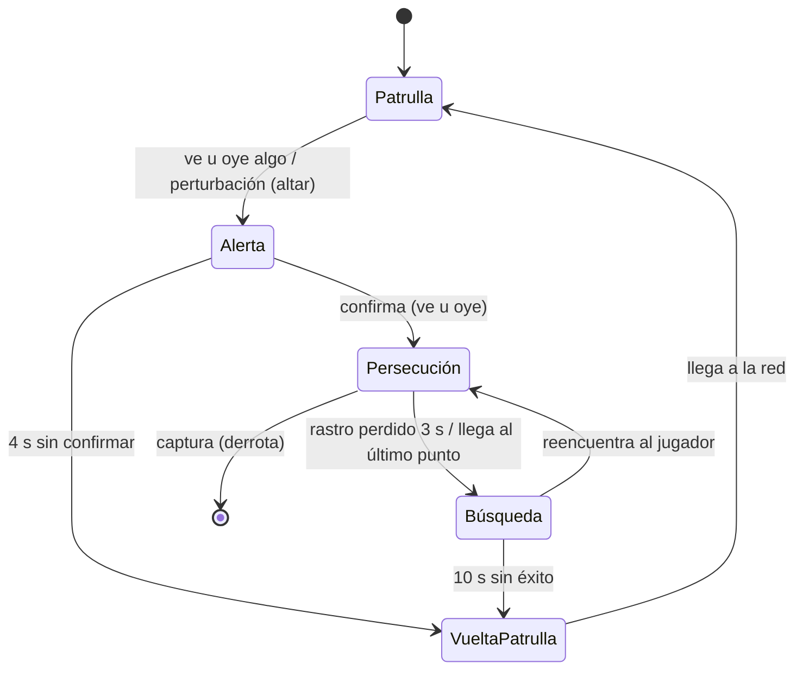

# El Guardián del Bosque Encantado — Presentación (4/11/2026)

**PIAPC · TP Final Integrador · Lautaro Rosales**
Repositorio: <https://github.com/LautaroNRosales/El-Guardi-n-del-Bosque-Encantado>

> Guion de exposición (~10 min): idea → demostración → métodos → navegación → IA → desarrollo → conclusiones.

---

## 1. Idea y escenario

- Juego de **sigilo 2D** vista superior: un espíritu debe activar **3 altares** y escapar por el **portal**.
- El **Guardián** patrulla y persigue si detecta. **Sin combate**: esconderse, planear y evitar ser visto u oído.
- Escenario: grilla 15×15 de senderos, árboles y rocas (bloquean paso y visión), arbustos (esconden), altares (bloquean visión).
- **Validación garantizada**: antes de jugar, BFS comprueba inicio→altares→portal; si falla, «carve» (A\* con costo) abre paso. **Toda variante es jugable.** Variante nueva con la tecla **R**.

## 2. Qué cambia entre partidas (generación)

- Varián: árboles/rocas no esenciales, arbustos, posición de altares y portal, orden/conexiones de waypoints, forma de senderos.
- **Siempre válido**: comprobado por búsqueda en `mapgen.ts` + test automatizado con **100 semillas** (`npm run test`).
- La patrulla **se adapta**: la red de waypoints se reconstruye por variante; los enlaces se calculan por A\* sobre el mapa real.

## 3. Métodos de búsqueda: A\* vs BFS

| | A\* | BFS |
|---|---|---|
| Tipo | Informada (heurística Manhattan) | No informada (por capas) |
| Óptimo con costos uniformes | **Óptimo**, expande **menos** nodos | **Óptimo**, expande **más** (anillo por anillo) |
| Uso en el juego | Persecución, retorno, investigación | Barrido de la zona en la Búsqueda |
| Selección en vivo | **Panel «Métodos» del HUD** | **Panel «Métodos» del HUD** |

- **Ambos seleccionables y observables jugando**: con **F2** se ve la ruta (ámbar = A\*, celeste = BFS) y el contador `expandidos: N` en vivo.
- Con costos uniformes ambos devuelven **el mismo camino óptimo**; la diferencia observable es cuántos nodos expanden (y su criterio de expansión, visible en F2).
- Si no existe camino (destino inalcanzable): el guardián **se detiene en celda válida**, espera 2 s y vuelve a la patrulla — nunca atraviesa obstáculos ni queda en estado ilegal (cubierto por spec y test).

## 4. Alternativas de navegación (planificación del desplazamiento)

Dos estrategias distintas (no basta cambiar de algoritmo), **seleccionables en el HUD**:

| | Red de waypoints | Grilla dinámica |
|---|---|---|
| Idea | Seguir enlaces precalculados entre nodos de interés | Recalcular la ruta en vivo en cada paso |
| Fortaleza | Predecible, eficiente, adaptable al escenario | Reacciona al instante ante cambios |
| Cómo se ve (F2) | Polilíneas entre nodos; el guardián salta de nodo en nodo | Ruta fresca hacia el objetivo; se actualiza en vivo |
| Adaptación a otra variante | Se reconstruye la red: rutas distintas | Se adapta automáticamente al recalcular |

- Ante **obstáculos o camino bloqueado**: waypoints se recalcula por variante; grilla dinámica se recalcula siempre; si nada es alcanzable, el guardián se detiene y **retoma la patrulla**.
- Demo: alternar «Navegación» en Métodos con el guardián en patrulla y observar el recorrido cambiar; pulsar **R** y comparar.

## 5. La IA del Guardián

**Percepción**
- Visión: cono **90°** orientado a la marcha; alcances **8** (solo de pie, sin obstáculos) / **5** (seguro) / **2** (cercanía: ve incluso agachado). Línea de visión bloqueada por **árboles, rocas y altares** (muestreo de línea sobre la grilla). **Escondido en arbusto = invisible** (y no puede capturarte mientras estés oculto; volvés a ser vulnerable al salir).
- Oído: **correr 6 celdas** / **caminar 1** / quieto o agachado / **nada**.
- **Umbral de pérdida de rastro**: 3 s sin confirmar → deja de perseguir y pasa a Búsqueda.

**FSM — 5 estados**

- **Investigación**: activar un altar envía una «perturbación» a esa coordenada: el guardián va a inspeccionar (Alerta orientada y avance hacia la fuente).
- **Última posición conocida** (`lastKnown`): base de Persecución (A\*/BFS) y del barrido BFS de la Búsqueda.
- El comportamiento cambia en vivo con: línea de visión, ruido del jugador, postura (agachado/escondido), perturbaciones y temporizadores (4 s / 3 s / 10 s).

**Objetivos del NPC**: capturar al jugador · cubrir zonas clave (patrulla por la red) · investigar alteraciones (ruidos, altares).

## 6. Desarrollo con OpenCode

**Cómo se usó**: exploración del repo → plan → especificación → implementación guiada por specs → pruebas → revisión.

- **Specs primero** (`specs/`): por ej. `specs/persecucion.md` define objetivo, comportamiento esperado, fuera de alcance y **cómo comprobarlo** (sin jugador visible patrulla; con línea de visión persigue; con muro no detecta; sin camino no atraviesa ni se bloquea; BFS/A* seleccionables en vivo).
- **Qué aportó OpenCode**: andamiaje del proyecto (Vite+TS), implementación de grilla/A*/BFS/carve/waypoints/FSM, tests (100 semillas y simulación de la FSM), revisión de arquitectura y de bugs (p. ej., carve no debe abrir altares; `edgePath` reorientación de aristas; integración de perturbaciones).
- **Decisiones y correcciones propias** (sobre la propuesta del agente):
  1. **Carve garantizado**: la validación sola podía descartar variantes; se agregó A\* con costo 1/6 que **abre** el bosque hasta conectar inicio→altares→portal (toda variante es jugable, sin reintentos infinitos).
  2. **Escondido = invisible**: regla simple y comunicada en HUD/specs; el guardián no "siente" al jugador en el arbusto; el jugador sale con E.
  3. **Selección de métodos en el HUD** (A\*/BFS y navegación): requisito de la consigna; no alcanzaba con dos rutas hardcodeadas; el evaluador las alterna jugando.
  4. **Altares bloquean visión** (GDD) y rompen el LOS; no bloquean movimiento del guardián porque no aplica; portal sí transitable.
  5. **Perturbación por altar** para cubrir «investigar alteraciones» (GDD 3.3) sin mecánicas extra.
- **Verificación**: `npm run test` → 212 tests verdes (mapgen ×100 semillas, optimalidad A\*, equivalencia, barrido, LOS, **simulación FSM**: detección→alerta→persecución→captura; pared y arbusto = no detectado).

## 7. Demo en vivo (guion)

1. Abrir `npm run dev` → menú → **F2** (waypoints + enlaces) y **F3** (grilla).
2. **R** para generar otra variante ×2: comparar la patrulla (red distinta, rutas por A\*).
3. Alternar **Búsqueda A\*/BFS**: provocar persecución y mostrar `expandidos` (F2).
4. Alternar **Navegación** waypoints ↔ grilla dinámica en patrulla.
5. **Esconderse** (E en arbusto) y pasar agachado: el guardián no detecta (F1: cono recortado por muros).
6. Activar un **altar**: suena la campana y el guardián **va a investigar**.
7. Activar los 3 altares → **portal** → victoria (ruta de regreso: ser vistos de cerca = derrota).
8. (Opcional) Forzar un escenario sin camino: el guardián se detiene y **retoma la patrulla**.

## 8. Limitaciones

- Un único Guardián; mapa estático durante la partida (el bosque "cambia" entre partidas, no dentro de ella).
- Sin dificultad, puntuación, niveles ni múltiples guardianes (GDD 7.2).
- LOS por muestreo: suficientemente preciso para 15×15; no hay occlusion culling avanzada.
- El "amanecer" del GDD no se materializa como temporizador (excluido por GDD 7.2).

## 9. Conclusiones

- Se logró el **prototipo funcional completo del GDD 7.1**: 1 NPC con 5 estados, percepción cono+oído, A\* y BFS **seleccionables**, **2 alternativas de navegación**, generación procedural con **validez garantizada** y **adaptación de patrullaje** al escenario.
- La consigna queda cubierta punto por punto (ver README «Consigna ↔ implementación»).
- Aprendizaje clave: la **búsqueda** (calcular camino) y la **navegación** (planificar/recorrer) son decisiones distintas; hacerlas seleccionables en el HUD convierte la demo en una defensa de método, no en un video.

## 10. Qué mejoraría

- **Ruta segura** (costos no uniformes: penalizar celdas expuestas a la visión) con Dijkstra/A\* sobre costos reales; explicar qué algoritmo admite esos costos y por qué BFS no.
- Un segundo Guardián con reparto de zonas (coordinación básica por nodos).
- Seeds "curadas" para la exposición + guardado de mejores variantes.
- HFSM si se agregan más arquetipos de NPC.

---

### Respuestas rápidas para preguntas

- **¿Por qué dos navegaciones y no solo dos algoritmos?** Porque la consigna lo exige: la búsqueda calcula un camino; la navegación define cómo se selecciona/recorre. Cambiar BFS por A\* no era suficiente.
- **¿El patrullaje es fijo?** No: la red se reconstruye por variante (nodos válidos, enlaces por A\*, union-find para conexidad).
- **¿Qué garantiza que el mapa sea jugable?** BFS de validación + carve. Test con 100 semillas.
- **¿Qué pasa si no hay camino?** El guardián no atraviesa obstáculos; espera y retoma patrulla.
- **¿Dónde está la spec?** `specs/persecucion.md` (y 3 más).
